<div align="center">


# LinguaReader

**Read real books, ebooks, comics and scans in the language you're learning.<br>Select a word to translate it, save it, and review it before you forget it.**

[](https://github.com/yusufdinc974/LinguaReader/releases/latest)
[](#download)
[](LICENSE)

[**Download**](#download) · [Features](#features) · [Screenshots](#screenshots) · [Build from source](#build-from-source) · [Contributing](#contributing) · [Website](https://lingua-reader-web.vercel.app/)

<br>

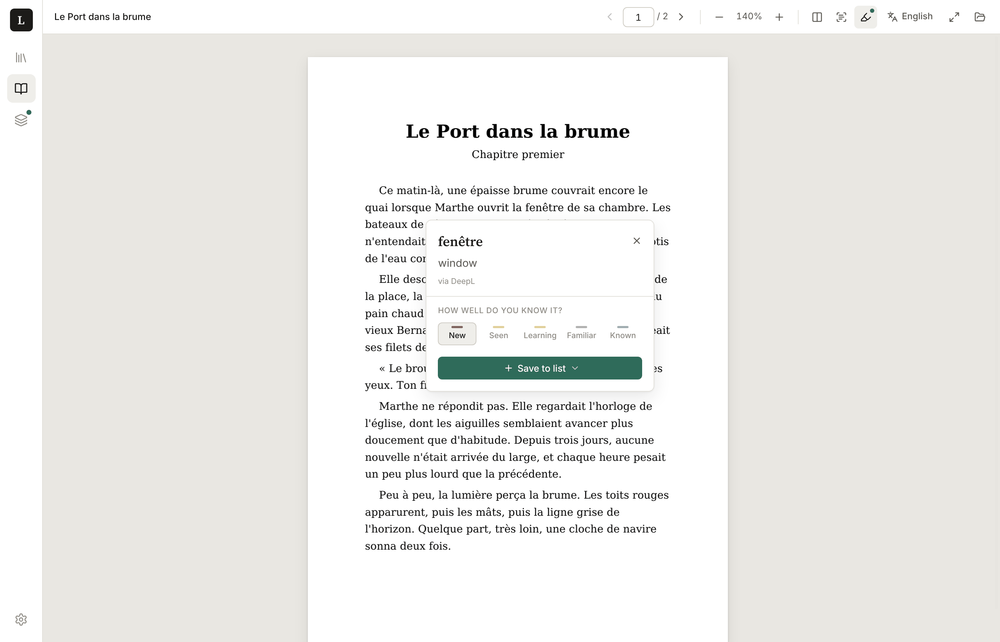

</div>

<br>

## Features

### 📖 A reader made for learning
- **Select any word or phrase** to translate it in context, then save it to a list with one click.
- **Saved words stay highlighted** in every book, colored by list, so you notice them again while you read.
- **Rate how well you know a word** right where you meet it: New, Seen, Learning, Familiar or Known.
- **EPUB books** open as clean, reflowing text with their table of contents, in light or dark.
- **Picks up where you left off.** Every book reopens at the page you were on, and EPUBs at the very spot in the chapter.
- Single page, two-page spread or continuous scroll, zoom, and a distraction-free focus mode.

### 🖼️ Scans, manga and webtoons (OCR)
- **Text in pictures becomes selectable.** Scanned PDFs, images (PNG, JPG, WebP, GIF, BMP, AVIF) and CBZ comics get a hidden text layer, so you can translate and save words from them like from any other page.
- **Many alphabets.** Latin, Chinese and Japanese, Cyrillic, Korean, Arabic, Greek, Thai, Devanagari, Tamil and Telugu. The alphabet is detected automatically, or you can set it per book.
- **Manga ready.** Vertical Japanese columns, speech bubbles read right to left, furigana skipped.
- **Webtoon mode.** Long strips scroll as one continuous page.
- **Offline and private.** Recognition runs on your computer with PaddleOCR models, and each page is read only once.

### 🧠 Spaced-repetition review
- **Three ways to practise:** Flashcards (recall the meaning and rate yourself), Choice (pick the right translation out of four) and Reverse (see the translation, find the word).
- **Words in context.** Each saved word keeps the sentence you found it in, and review cards show it (with the word blanked out in Reverse mode).
- **Smart scheduling.** Words come back right before you'd forget them. Only your first answer in a session counts, and "Unsure" still counts as a pass.
- **See what's coming.** The Words page shows what's due now and a 14-day forecast.
- **Keyboard friendly.** Space to reveal, 1 / 2 / 3 to answer, Esc to leave.

### 🌐 Translation
- Translate into 20 languages, including English, Turkish, German, French, Spanish, Russian, Ukrainian and Portuguese.
- **Free out of the box** with MyMemory, or add your own **DeepL API key** for better translations.
- Your DeepL key is **stored encrypted** with your system's keychain, and it never goes into backups or phone sync.

### 🔒 Your data stays yours
- Everything is stored locally. No account, no tracking.
- **Backup and restore** your lists, words and review progress as a JSON file.
- **Phone sync** with LinguaReader for Android over your own Wi-Fi, paired with a one-time QR code.
- Light and dark themes.

## Screenshots

<table>
  <tr>
    <td width="50%">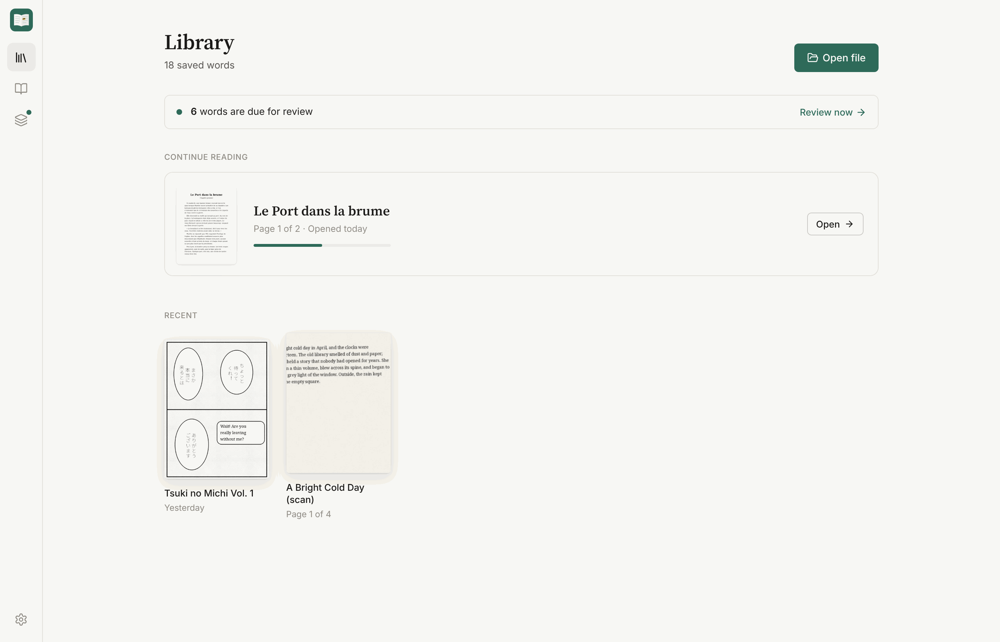</td>
    <td width="50%">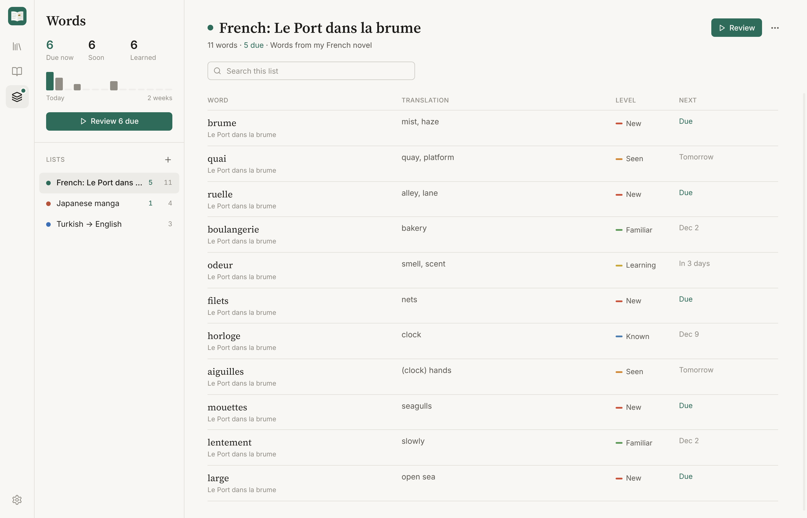</td>
  </tr>
  <tr>
    <td align="center"><b>Library</b><br><sub>Continue where you stopped, see what's due.</sub></td>
    <td align="center"><b>Words</b><br><sub>Lists, levels and the review forecast.</sub></td>
  </tr>
  <tr>
    <td>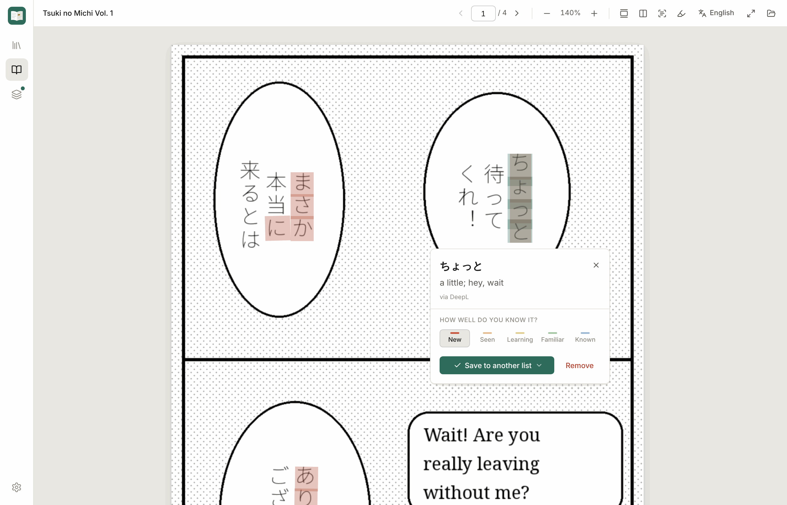</td>
    <td>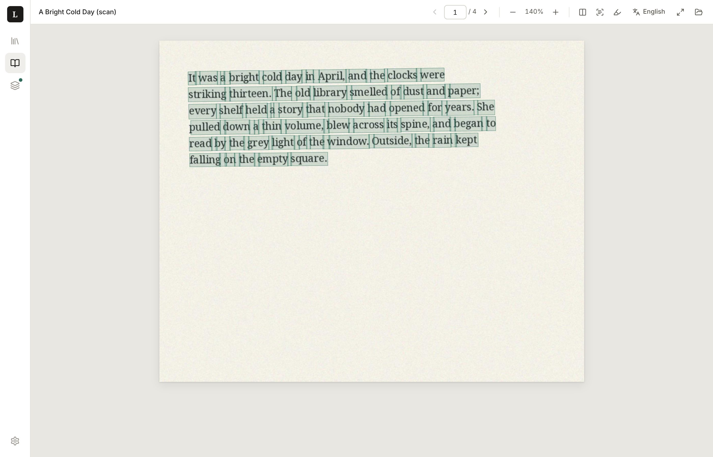</td>
  </tr>
  <tr>
    <td align="center"><b>Manga</b><br><sub>Select vertical Japanese like normal text.</sub></td>
    <td align="center"><b>Scanned books</b><br><sub>The recognised text layer, made visible for this picture.</sub></td>
  </tr>
  <tr>
    <td>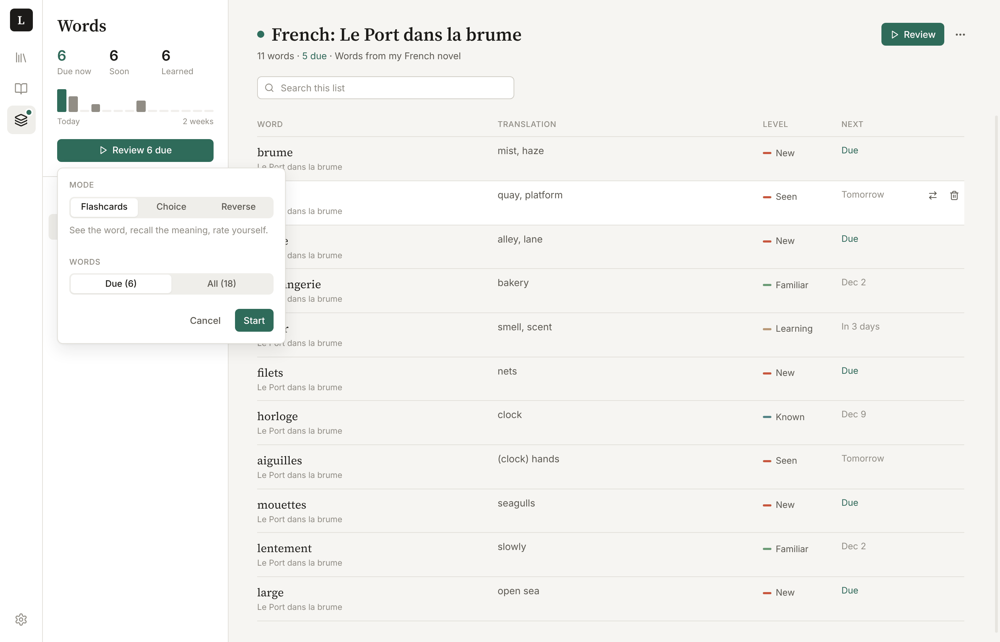</td>
    <td>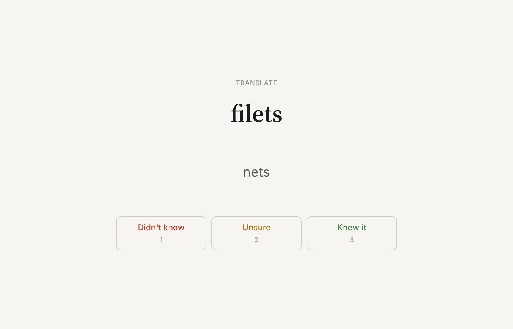</td>
  </tr>
  <tr>
    <td align="center"><b>Start a review</b><br><sub>Pick a mode, and due words or all of them.</sub></td>
    <td align="center"><b>Flashcards</b><br><sub>Rate yourself with 1, 2 or 3.</sub></td>
  </tr>
  <tr>
    <td>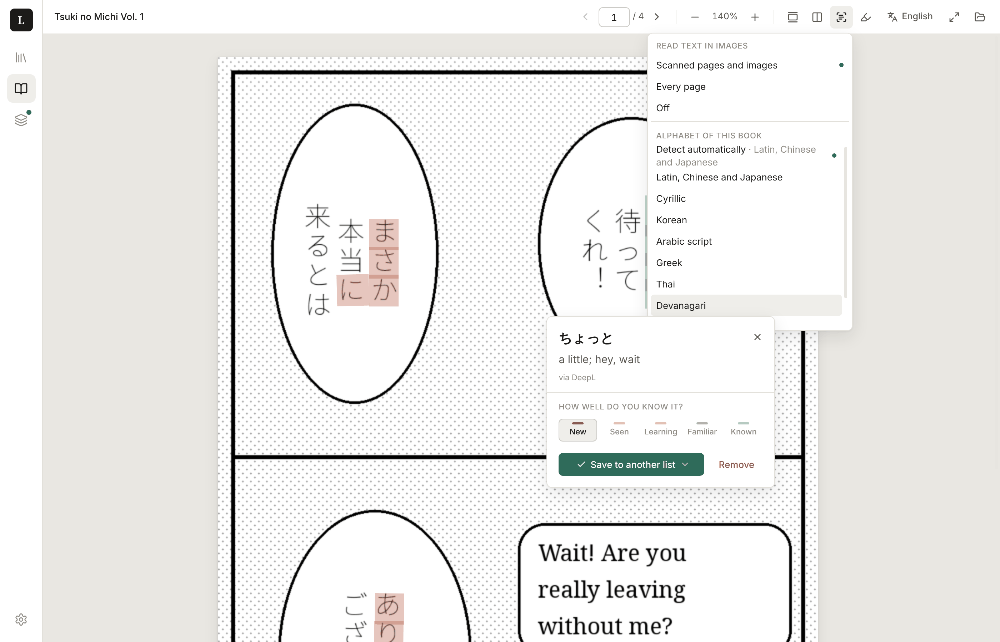</td>
    <td>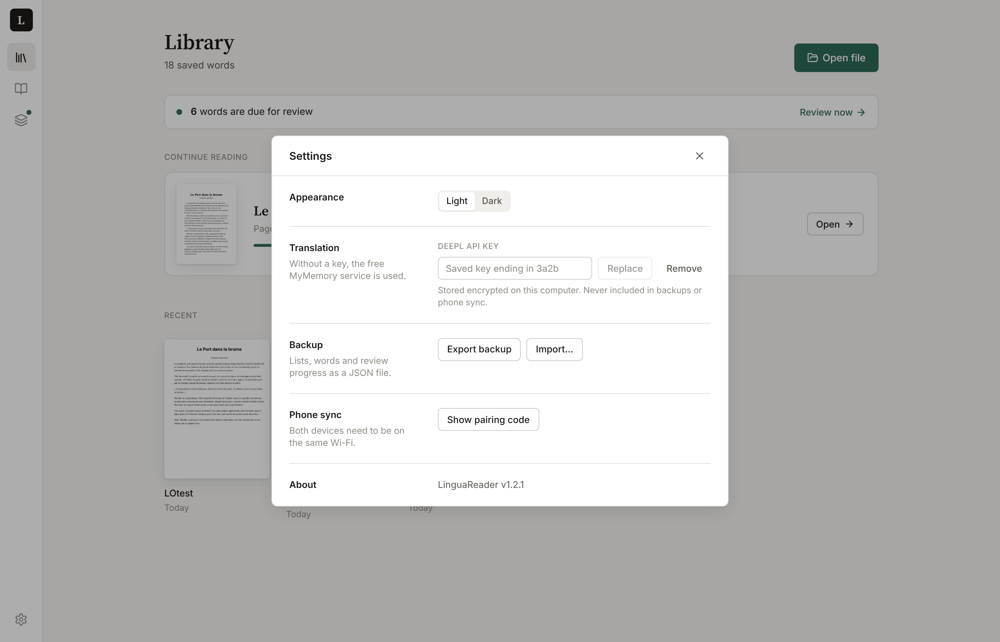</td>
  </tr>
  <tr>
    <td align="center"><b>Text recognition</b><br><sub>When to read text in images, and which alphabet.</sub></td>
    <td align="center"><b>Settings</b><br><sub>DeepL key, backups and phone sync.</sub></td>
  </tr>
  <tr>
    <td>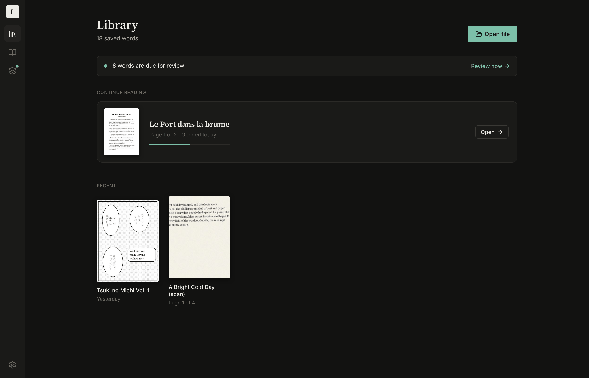</td>
    <td>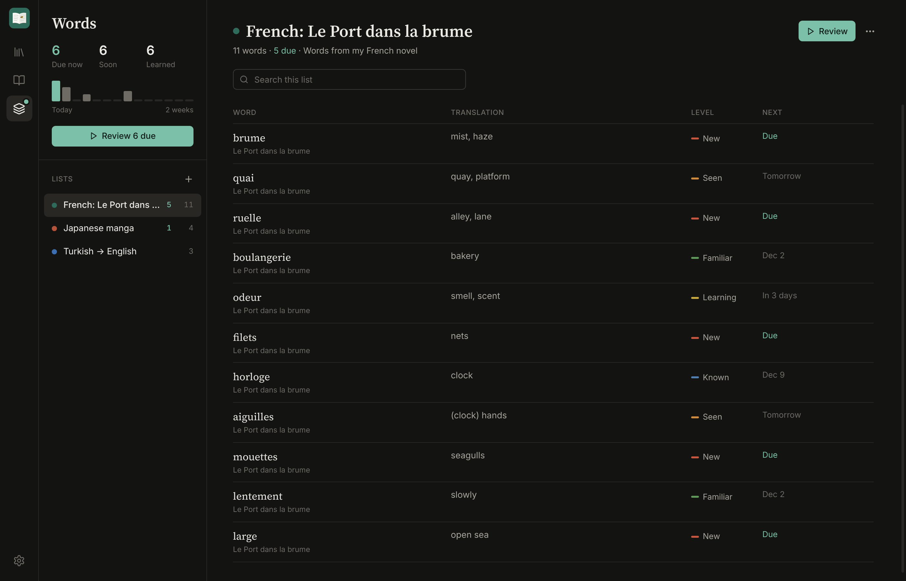</td>
  </tr>
  <tr>
    <td align="center" colspan="2"><b>Dark theme</b></td>
  </tr>
</table>

## Download

Get the latest version from the **[Releases page](https://github.com/yusufdinc974/LinguaReader/releases/latest)**.

| Platform | File | Notes |
|---|---|---|
| **Windows** (64-bit) | `LinguaReader-Setup-<version>.exe` | Installer |
| | `LinguaReader-<version>-portable.exe` | Portable, nothing to install |
| **macOS** (Apple Silicon) | `LinguaReader-<version>-arm64.dmg` | Drag to Applications |
| **Linux** (x64) | `LinguaReader-<version>.AppImage` | Runs on most distributions |
| | `linguareader_<version>_amd64.deb` | Debian, Ubuntu, Mint and others |

<details>
<summary><b>Windows</b>: "Windows protected your PC"</summary>

The app isn't code-signed yet, so SmartScreen may warn the first time. Click **More info**, then **Run anyway**.
</details>

<details>
<summary><b>macOS</b>: "LinguaReader can't be opened" or "is damaged"</summary>

The app isn't notarized by Apple yet, so Gatekeeper blocks it the first time. Open LinguaReader once, close the warning, then go to **System Settings → Privacy & Security** and click **Open Anyway** next to the LinguaReader message. On macOS 14 and earlier you can instead right-click LinguaReader in Applications and choose **Open**.

If macOS says the app **is damaged and can't be opened** (versions 1.2.1 and earlier), run this once in Terminal and open it again:

```bash
xattr -cr /Applications/LinguaReader.app
```

The macOS build is for Apple Silicon (M1 and later).
</details>

<details>
<summary><b>Linux</b>: AppImage and .deb</summary>

**AppImage**

```bash
chmod +x LinguaReader-*.AppImage
./LinguaReader-*.AppImage
```

On systems that block the Chromium sandbox for AppImages (such as Ubuntu 24.04), the AppImage runs without it.

**.deb**

```bash
sudo apt install ./linguareader_*_amd64.deb
```

The .deb keeps the Chromium sandbox on. Launch LinguaReader from your applications menu.
</details>

### Updates

LinguaReader checks for a new version at startup. On **Windows** and **Linux**, one click downloads it and it installs when you quit the app. On **macOS**, the app tells you about the new version and opens the Releases page for you to download it.

## Using LinguaReader

1. **Open a book.** Click **Open file** and pick a PDF, an EPUB book, a CBZ comic or an image. You can also open a file with LinguaReader from your file manager.
2. **Select a word or phrase.** Double-click a word, or drag across several. A card shows the translation.
3. **Save it.** Choose how well you know it, then **Save to list**. You can make a new list from the same menu.
4. **Review.** When words are due, the Library tells you. Click **Review now**, or start a review from the Words page.

The translation target language is in the reader's toolbar. Add a DeepL key under **Settings → Translation**.

## Build from source

You need **Node.js 22** or later and npm.

```bash
git clone https://github.com/yusufdinc974/LinguaReader.git
cd LinguaReader
npm install
npm run dev        # Vite + Electron with hot reload
```

The first `npm run dev` or `npm run build` downloads the OCR models (about 96 MB) into `resources/ocr/` and checks each file's SHA-256. To fetch them by hand, run `npm run fetch-ocr-models`.

| Command | What it does |
|---|---|
| `npm test` | Unit tests (review scheduling, OCR, security) |
| `npm run build:win` | Windows installer and portable `.exe` |
| `npm run build:mac` | macOS `.dmg` and `.zip` |
| `npm run build:linux` | Linux `.AppImage` and `.deb` |

Installers land in `release/`. Built with Electron, React, TypeScript, Vite, Tailwind CSS, pdf.js, SQLite (better-sqlite3) and ONNX Runtime.

## Contributing

LinguaReader is open source, and help of any size is welcome: a bug report, a translation fix, a test, or a whole feature.

### Ways to help

- 🐛 **Report a bug.** [Open an issue](https://github.com/yusufdinc974/LinguaReader/issues/new) with what you did, what you expected and what happened. Add your OS, the app version (**Settings → About**) and, if you can, the file that shows the problem.
- 💡 **Suggest a feature.** Open an issue that describes the problem it solves for language learners, not only the solution.
- 🔤 **Test a language.** OCR and word selection behave differently in every script. Telling us how LinguaReader handles your language is very useful, especially for Korean, Arabic, Thai and the Indic scripts.
- 🛠️ **Send a pull request.** For anything bigger than a small fix, open an issue first so we can agree on the approach.

### Your first pull request

1. Fork the repository and create a branch from `main`, for example `fix/cbz-page-order`.
2. Set up the app as in [Build from source](#build-from-source) and run `npm run dev`.
3. Make your change. Keep the pull request about one thing.
4. Check it before you push:
   ```bash
   npm test                                # unit tests
   npx tsc --noEmit                        # type check the UI
   npx tsc --noEmit -p tsconfig.electron.json   # type check the main process
   ```
5. Open the pull request. Say what changed and why, how you tested it, and add a screenshot for anything visible.

Every pull request builds and installs the app on Windows and macOS and checks that OCR still works, so give the checks a few minutes.

### Where things live

| Folder | What's in it |
|---|---|
| `src/pages/` | The four screens: Library, Reader, Words, Review |
| `src/components/` | Sidebar, settings, word card, page view and other UI pieces |
| `src/lib/` | Reader logic: PDF, EPUB and comic loading, text layer, highlights, OCR layer, spaced repetition |
| `electron/` | Main process: database, IPC, file access, updates, phone sync, DeepL key storage |
| `electron/ocr/` | The OCR worker (PaddleOCR models on ONNX Runtime) |
| `test/` | Unit tests, fixtures and the end-to-end OCR check |

### Guidelines

- **TypeScript, no type errors.** Match the style of the code around your change.
- **Keep it safe.** The renderer is sandboxed and talks to the main process only through `electron/preload.ts`. New IPC handlers must check their arguments, and the app must never read a file the user didn't open.
- **Keep it private.** No telemetry, and no new network calls beyond what a feature needs (translation, update checks, phone sync on the local network).
- **Write for learners.** Interface text should be short, plain English.

More detail is in [CONTRIBUTING.md](CONTRIBUTING.md).

## License

LinguaReader is released under the [MIT License](LICENSE).

The bundled OCR models are [PaddleOCR](https://github.com/PaddlePaddle/PaddleOCR) PP-OCRv6 and PP-OCRv5 models (Apache License 2.0), run with [ONNX Runtime](https://github.com/microsoft/onnxruntime) (MIT).

<div align="center">
<br>
<sub>Made with ❤️ by <a href="https://github.com/yusufdinc974">Yusuf Dinc</a></sub>
</div>
